<div align="center">



# 🏦 BankNest

**A modern digital banking platform — built end-to-end with Spring Boot & React.**

Open an account in seconds, transfer funds with row-level safety, and watch your
money move in real time. Fully deployed, fully serverless-from-your-laptop: no
local machine required to run it.

[](https://banknest-app.onrender.com)
[](https://banknest-api.onrender.com/api/health)
[](https://github.com/siddhant-pardeshi/BankNest/actions)

</div>

---

## ✨ What it does

| | |
|---|---|
| 🔐 **Secure accounts** | Registration and login backed by BCrypt-hashed passwords and stateless JWT sessions |
| 💰 **Deposits & withdrawals** | Real-time balance updates with transactional integrity |
| 🔄 **Fund transfers** | Pessimistic row-level locking on both accounts — balances can never race negative |
| 👥 **Beneficiaries** | Save trusted recipients with duplicate detection for faster transfers |
| 📜 **Transaction history** | Every deposit, withdrawal, and transfer in one consolidated ledger |
| 🎨 **Motion design** | Animated balance count-ups, route transitions, scroll-revealed sections, and reduced-motion support |

## 🧰 Tech stack

| Backend | Frontend | Infrastructure |
|---|---|---|
| Java 17 · Spring Boot 3.2 | React 19 · React Router 7 | Docker (multi-stage build) |
| Spring Security + JWT (jjwt) | Axios · Context API | Render — API (Singapore) |
| Spring Data JPA · Hibernate | Bootstrap 5 · Bootstrap Icons | Render — static CDN frontend |
| MySQL (Aiven Cloud, TLS) | Custom CSS motion system | GitHub Actions CI |

## 🚀 Live demo

- **Frontend:** [https://banknest-app.onrender.com](https://banknest-app.onrender.com)
- **API health:** [https://banknest-api.onrender.com/api/health](https://banknest-api.onrender.com/api/health)

> **Note on the free tier:** the API runs on Render's free plan, which sleeps the
> service after ~15 minutes of inactivity. The first request after a nap takes
> ~60 seconds while the container warms up (the page itself loads instantly —
> only the first API call waits). Subsequent requests are fast.

### Try it

1. Open the app and click **Open Account** — you'll start with a ₹1,000 welcome bonus.
2. Log in and explore the dashboard: deposit, withdraw, or transfer.
3. To see a transfer land, register a second account and send money to its
   10-digit account number from the first account.

## 🗺️ Architecture

```
┌─────────────────────────┐         ┌──────────────────────────────┐
│  React SPA (CDN)        │  HTTPS  │  Spring Boot API (Docker)    │
│  banknest-app.onrender  │ ──────► │  banknest-api.onrender       │
│                         │  JWT    │                              │
│  pages/ components/     │         │  controller → service → repo │
│  context/ services/     │         │  Spring Security filter chain│
└─────────────────────────┘         └──────────────┬───────────────┘
                                                   │ TLS (sslMode=REQUIRED)
                                    ┌──────────────▼───────────────┐
                                    │  MySQL — Aiven Cloud         │
                                    │  users · accounts ·          │
                                    │  transactions · beneficiaries│
                                    └──────────────────────────────┘
```

**Layered backend:** `@RestController` endpoints → `@Service` business logic →
Spring Data repositories. Every request passes a JWT filter that resolves the
user into a `UserPrincipal`; controllers never trust client-supplied identity.

## 🔌 API reference

All endpoints are JSON over HTTPS. Authenticated endpoints require
`Authorization: Bearer <token>`.

| Method | Endpoint | Auth | Description |
|---|---|---|---|
| `POST` | `/api/auth/register` | — | Create user + account (₹1,000 welcome bonus) |
| `POST` | `/api/auth/login` | — | Returns JWT + account number |
| `GET` | `/api/health` | — | Service health probe |
| `GET` | `/api/account/details` | ✅ | Account overview (owner, type, balance, status) |
| `GET` | `/api/account/balance` | ✅ | Current balance |
| `POST` | `/api/account/deposit` | ✅ | Deposit funds |
| `POST` | `/api/account/withdraw` | ✅ | Withdraw funds (insufficient-balance guard) |
| `POST` | `/api/account/transfer` | ✅ | Transfer funds (row-locked, atomic) |
| `GET` | `/api/transactions/history` | ✅ | Ledger for the caller's account |
| `GET` | `/api/beneficiaries` | ✅ | List saved beneficiaries |
| `POST` | `/api/beneficiaries` | ✅ | Add beneficiary (duplicate-checked) |
| `DELETE` | `/api/beneficiaries/{id}` | ✅ | Remove beneficiary |

## 🛠️ Run it locally

**Backend** (needs Java 17; uses MySQL — set `DB_URL`, `DB_USERNAME`,
`DB_PASSWORD` or point at a local instance):

```bash
cd BankNest
./mvnw spring-boot:run        # Windows: mvnw.cmd spring-boot:run
```

**Frontend** (needs Node 18+):

```bash
cd banknest-frontend
cp .env.example .env          # defaults to http://localhost:8080/api
npm install
npm start                     # http://localhost:3000
```

**Docker** (backend only, no local Java needed):

```bash
docker build -t banknest-api .
docker run -p 8080:8080 \
  -e DB_URL="jdbc:mysql://host:3306/db" \
  -e DB_USERNAME=... -e DB_PASSWORD=... \
  banknest-api
```

## 🧪 Quality gates

- **17 unit tests** covering auth (hashing, duplicate emails, deactivated
  accounts), transfers (success, insufficient funds, self-transfer, unknown
  recipient, zero amount), and JWT round-trip/tamper rejection.
- GitHub Actions runs backend tests + frontend build on every push.
- Money math uses `BigDecimal` end to end — no floating point.

## 🔒 Security notes

- Passwords are BCrypt-hashed; raw passwords are never stored or logged.
- Tokens expire after 24h and are verified with HMAC-SHA256.
- The `/api/auth/**` and `/api/health` routes are public — everything else
  requires a valid token and returns `401` otherwise.
- CORS is env-driven (`CORS_ALLOWED_ORIGINS`) rather than hardcoded.
- All cloud credentials live in Render environment variables, never in git.

---

<div align="center">

**BankNest** — banking that feels as good as it works.

</div>
